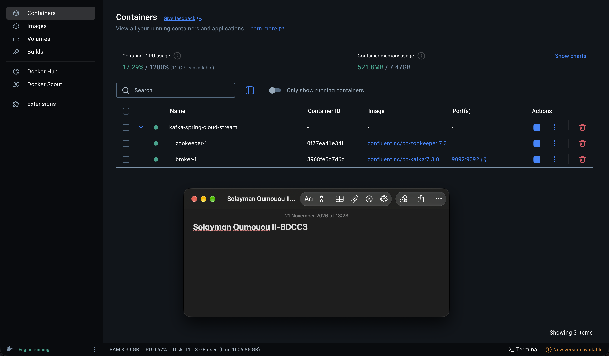
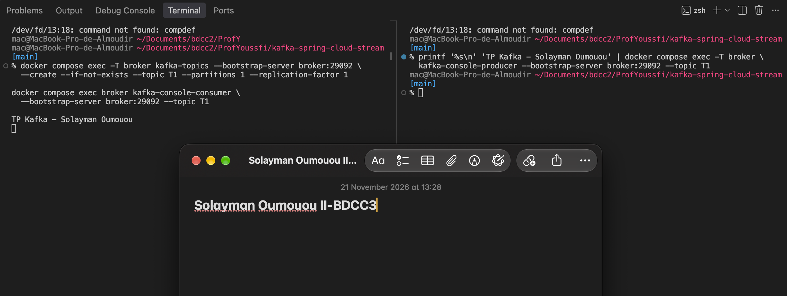
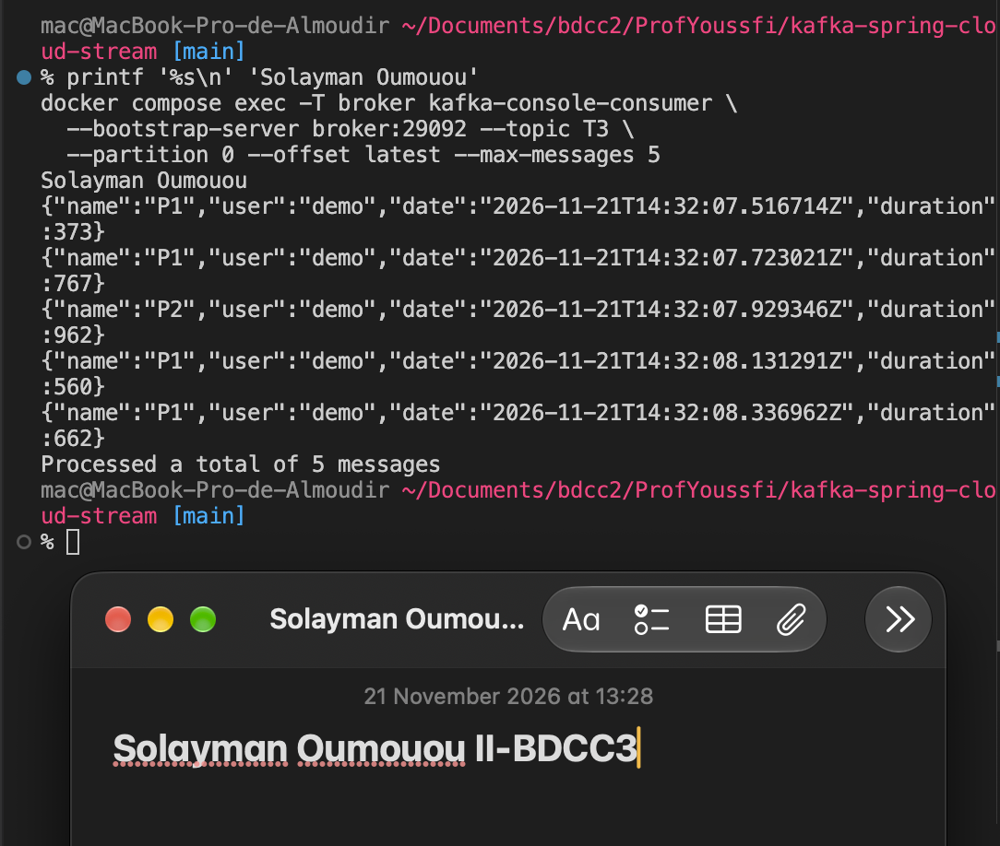
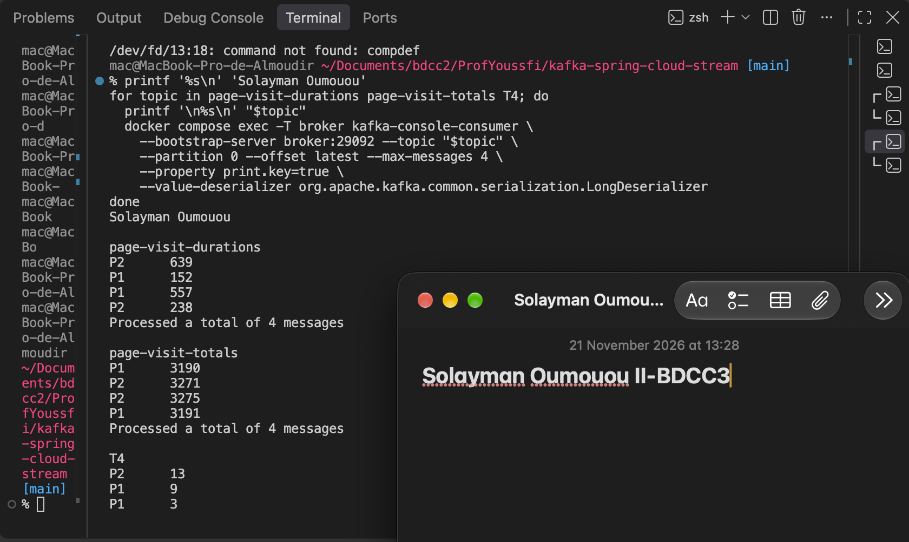
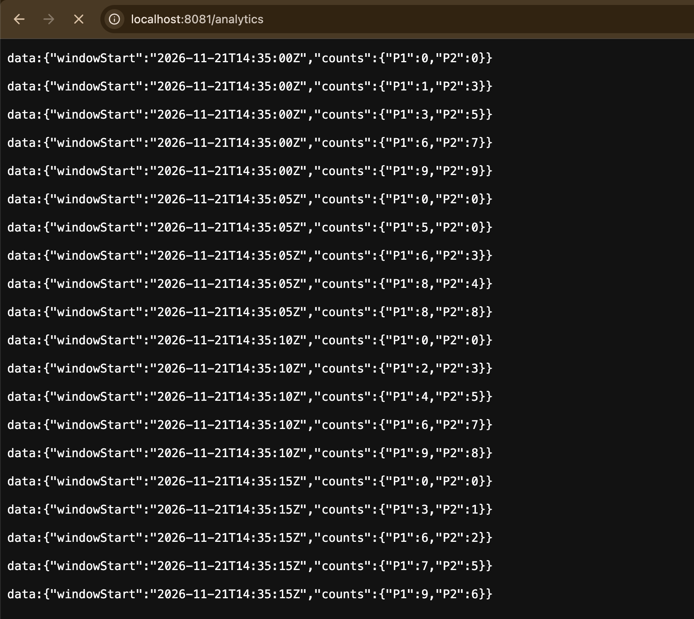
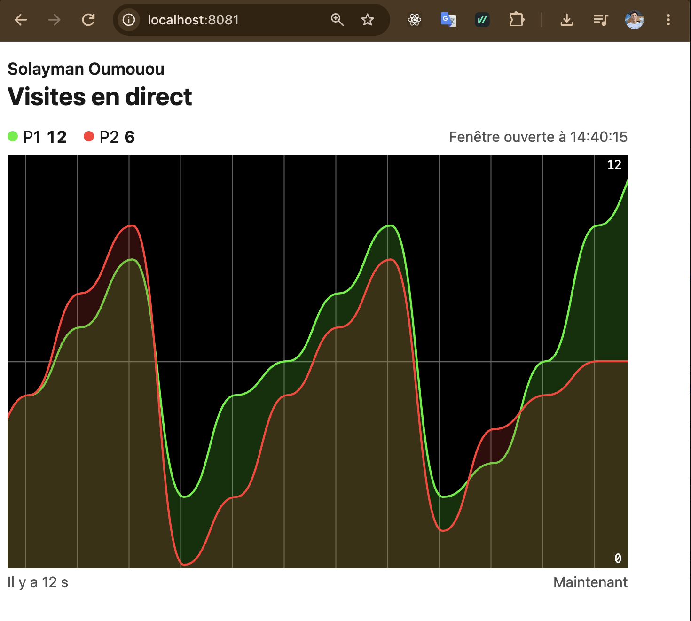

# TP 3 — Architecture événementielle avec Kafka

**Solayman Oumouou II-BDDC3 2026-2027**

## Lancer le TP

```bash
docker compose up -d --wait
./mvnw spring-boot:run
```

Kafka et ZooKeeper tournent dans Docker. Le producteur et le consommateur en ligne de commande utilisent le topic `T1`.






Kafka Streams filtre les visites de 100 ms ou moins et calcule les compteurs par page. Le [tableau de bord](http://localhost:8081/) affiche les visites de P1 et P2 par fenêtre de cinq secondes.





